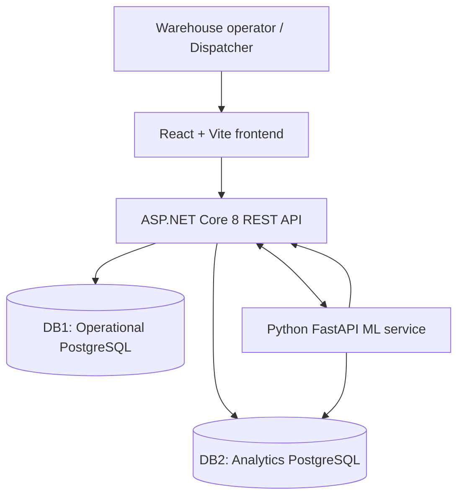

# In-Plant Warehouse Management System (WMS)

An integrated warehouse management system for internal factory logistics. The application supports supplier deliveries, pallet registration and storage, material replenishment for production lines, consumption recording, quality-related handling, and material-shortage prediction using machine learning.

The system combines a **React web application**, an **ASP.NET Core REST API**, a **Python/FastAPI ML service**, and two **PostgreSQL databases**. Docker Compose coordinates the services and provides a reproducible development environment.

## Features

### Warehouse operator — Skladník

- **Receiving deliveries:** Find supplier orders by number, register received pallets and quantities, and record packaging damage.
- **Receiving area:** Review pallets awaiting storage and their receipt approval status.
- **Warehouse storage:** Assign accepted pallets to available storage locations.
- **Production-line replenishment:** View open requests and send matching pallets to configured active production lines.
- **Material consumption:** Record the consumption of a pallet assigned to a production line, including its arrival time, consumption date, and duration.
- **Quarantine:** Isolate pallets and record reasons for quality-related issues.

### Dispatcher — Dispečer

- **Warehouse dashboard:** Monitor material quantities across storage, production lines, receiving, and quarantine.
- **Delivery deviations:** Review and approve or reject discrepancies between supplier orders and received quantities.
- **Replenishment management:** Create requests for materials, specify production lines, and assign priorities.
- **Production-line inventory:** View material quantities and pallets assigned to active production lines.
- **Master Data:** Create supplier orders (ORD), add/edit/activate/deactivate materials (MAT), and manage production lines (L). This page is available to the dispatcher role.
- **Quarantine decisions:** Process quarantine cases and direct pallets to rework or claim areas.
- **ML predictions and alerts:** View material-shortage risk estimates, expected time to stockout, recommended quantities, and acknowledge alerts.

## System architecture



The React frontend is compiled into static assets served by ASP.NET Core. The main backend processes warehouse operations, manages user sessions and operational records, and exposes HTTP endpoints to the frontend. The ML service uses consumption history and simulated telemetry to estimate shortage risk and sends critical alerts to the main backend.

### Technology stack

| Layer | Technology | Purpose |
| --- | --- | --- |
| Frontend | React 19, Vite, JavaScript, CSS | User interfaces and client-side routing |
| Main backend | C#, ASP.NET Core 8, Entity Framework Core | Warehouse business logic, authentication and REST API |
| ML service | Python 3.12, FastAPI, SQLAlchemy, scikit-learn | Consumption analytics, shortage prediction and alerts |
| Databases | PostgreSQL 16 | Operational data and analytical history |
| Deployment | Docker, Docker Compose | Service builds, configuration, networking and persistent storage |

## Warehouse workflows

### 1. Supplier delivery and receiving

The warehouse operator retrieves a supplier order and enters the delivered pallets. Each pallet has a unique code, material, quantity, and packaging-damage information. The backend compares the received quantities with the quantities expected by the order. Receipts are recorded with status `OK` or `WITH_DEVIATION`.

When deviations exist, the dispatcher reviews the receipt and records an approval or rejection. Accepted pallets can then be transferred from the receiving area to available warehouse storage locations. Pallet receipt and storage events are recorded in the analytical movement history.

### 2. Warehouse storage and inventory

The system tracks each pallet by its unique identifier, material, quantity, status, and location. Storage positions are marked as occupied or available. The dispatcher dashboard aggregates material quantities by warehouse state, and the production-line inventory view shows materials and individual pallets already assigned to a configured production line.

The main pallet statuses are `RECEIVED`, `STORED`, `ON_LINE`, `CONSUMED`, `QUARANTINE`, `REWORK`, `CLAIM`.

### 3. Material replenishment

The dispatcher creates a request specifying the required material, target production line, quantity, and priority. Priority values range from **1 (highest)** to **5 (lowest)**.

The warehouse operator sees open requests, selects a stored pallet of the requested material, and sends it to the specified production line. The backend changes the pallet status to `ON_LINE`, records its `LineName`, completes the replenishment request, and saves a `TO_LINE` movement event in DB2. The active production-line list is stored in DB1, so newly created lines become available in replenishment requests and line inventory.

### 4. Material consumption

For a pallet assigned to a production line, the warehouse operator records the consumption date, arrival time, and consumption duration. The backend calculates the start and end of the consumption interval, marks the pallet as `CONSUMED`, and writes the consumption details to the analytical database.

Two records are saved in DB2: a `LineConsumptionLogs` entry describing the material, line, quantity, and time interval, and a `MovementLogs` entry with event type `CONSUME`. These records provide historical data for consumption-rate analysis.

### 5. Quarantine and quality handling

The warehouse operator can move a pallet into quarantine and record a reason. The dispatcher reviews open quarantine cases and selects the appropriate resolution: transfer to a **rework** area or a **claim** area. Each status change and movement is recorded for historical analysis.

### 6. ML-based material shortage monitoring

The ML service processes line/material telemetry, historical consumption rates, current simulated stock, planned consumption, outstanding requests, and estimated replenishment time. It calculates the probability of a material shortage within a configurable prediction horizon.

When risk reaches the configured critical threshold, the ML service sends an alert to the ASP.NET backend. The backend creates or updates the corresponding operational alert and an automatically generated replenishment request. The dispatcher can view and acknowledge these alerts in the dashboard, while the warehouse operator handles the replenishment request using the normal material-delivery workflow.

## Machine learning and analytics

The Python service implements a **binary shortage-risk classifier**. The prediction target is whether a production line is likely to run out of a material within the selected time horizon. The default forecast horizon is **60 minutes**, and the default critical risk threshold is **70%**.

### Model training and evaluation

The service trains two candidate classifiers:

- **Logistic Regression** — a baseline model using standardized features.
- **Random Forest** — a tree-based model for nonlinear relationships between inventory and consumption features.

Candidates are evaluated on a held-out test split, and the model with the higher **ROC AUC** is selected. Recorded evaluation metrics include **accuracy, precision, recall, F1 score, and ROC AUC**. Trained models are stored using `joblib`, and model-version metrics are recorded in DB2.

The ML service uses historical `LineConsumptionLogs` records to calculate material consumption rates by production line. Its initial supervised training data is generated separately by the Python ML component. The service also supports model retraining through its API.

### Production-line simulator

A simulator generates periodic telemetry for the following line/material combinations:

| Production line | Materials |
| --- | --- |
| L1 | MAT-001, MAT-002 |
| L2 | MAT-002, MAT-003 |

In the Docker configuration, a simulator cycle runs every **30 seconds**, representing **10 minutes** of simulated production. The service reduces simulated material stock based on consumption rates, calculates risk, and processes subsequent stock updates from `TO_LINE` events recorded by the warehouse backend.

The dispatcher dashboard retrieves current predictions and alerts through the ASP.NET API and refreshes the ML information every **15 seconds**.

## Databases

The project uses two PostgreSQL databases, each serving a distinct part of the system.

### DB1 — `wms_operational`

Stores the current warehouse state and operational records:

| Entity | Stored information |
| --- | --- |
| `Users`, `Roles` | Accounts and role-based access |
| `Products` | Material codes, names, units, and active/inactive state |
| `ProductionLines` | Production line codes, names, locations, and active/inactive state |
| `Orders`, `OrderItems` | Supplier orders and expected material quantities |
| `Receipts` | Received deliveries and deviation decisions |
| `Pallets` | Pallet codes, quantities, locations, status, and line assignments |
| `Locations` | Warehouse locations, zones, and occupancy |
| `DamageRecords` | Packaging damage information |
| `ReplenishmentRequests` | Manual and ML-generated material requests |
| `QuarantineCases` | Quality-related pallet handling |
| `Alerts` | Shortage alerts for dispatchers |

### DB2 — `wms_analytics`

Stores historical events, consumption data, ML telemetry and predictions:

| Entity | Stored information |
| --- | --- |
| `MovementLogs` | Pallet movements and warehouse events |
| `LineConsumptionLogs` | Consumption quantity, material, production line, and time interval |
| `PredictionHistories` | Historical ML risk estimates and forecast information |
| `consumption_log` | Telemetry and calculated consumption inputs |
| `predictions` | Predictions, risk levels, and alert-processing state |
| `model_metrics` | Model versions, algorithms, and evaluation metrics |

The ASP.NET backend initializes its Entity Framework Core tables and sample data on startup. The Python service manages its own SQLAlchemy tables in the analytical database.

## Sample data

The main backend seeds demonstration data during initialization, including two user roles, three materials, supplier orders `ORD-001`–`ORD-005`, and warehouse locations. Storage locations include `LOC-A1`–`LOC-A25` and `LOC-B1`–`LOC-B25`, with shared receiving, quarantine, rework, claim, and line-buffer areas.

### Materials

| Code | Material | Unit |
| --- | --- | --- |
| `MAT-001` | 2 mm steel sheet | `ks` |
| `MAT-002` | M8 bolts | `ks` |
| `MAT-003` | Electric cable | `m` |

### Synthetic consumption history

`ConsumptionBootstrapper` generates **2,000 historical consumption records** for DB2: **1,000 for L1** and **1,000 for L2**, split evenly across the two materials assigned to each line. Records are distributed across working days in a 180-day historical window. Each record describes one full pallet's consumed quantity and a randomized consumption interval.

| Material | Quantity per pallet | Consumption duration |
| --- | --- | --- |
| MAT-001 | 100 ks / 200 ks | 40–55 min / 80–110 min |
| MAT-002 | 300 ks / 500 ks | 40–55 min / 70–90 min |
| MAT-003 | 100 m / 200 m | 30–45 min / 60–90 min |

The generator uses reproducible random seeds, timestamps, and short intervals between consecutive consumption records. Generated records are labeled with `Source = "synthetic"`. Previously initialized line/material groups are retained on subsequent application starts.

## Running the system with Docker

### Prerequisites

- Docker Desktop or Docker Engine with Docker Compose and BuildKit support.
- Docker Compose with support for `additional_contexts` and service build contexts.

### Start

From the repository root:

```bash
docker compose up -d --build
```

### Docker services

| Service | Responsibility |
| --- | --- |
| `app` | ASP.NET Core REST API and the compiled React frontend |
| `db1` | PostgreSQL operational database (`wms_operational`) |
| `db2` | PostgreSQL analytical database (`wms_analytics`) |
| `ml-service` | Python/FastAPI prediction and analytics service |

After startup, open:

| Interface | Address |
| --- | --- |
| WMS web application | http://localhost:8080 |
| ASP.NET API / Swagger | http://localhost:8080/swagger |
| ML API / Swagger | http://localhost:8001/docs |
| ML health check | http://localhost:8001/health |
| Operational PostgreSQL (DB1) | `localhost:5433` |
| Analytics PostgreSQL (DB2) | `localhost:5434` |

### Demo accounts

The initial database seed contains the following application accounts:

| Role | Username | Password |
| --- | --- | --- |
| Warehouse operator | `skladnik` | `sklad123` |
| Dispatcher | `dispecer` | `disp123` |

These credentials are intended for the local demonstration environment.

### Useful commands

```bash
docker compose ps                  # Inspect services
docker compose logs -f app         # ASP.NET application logs
docker compose logs -f ml-service  # ML service logs
docker compose logs -f db1 db2    # PostgreSQL logs
docker compose up -d --build       # Rebuild and start
docker compose down                # Stop services and preserve volumes
```

Docker Compose uses the named volumes `db1data`, `db2data`, and `mlmodels` to retain database contents and the trained ML model across container restarts.

## Local development

### Main backend

Requires the **.NET 8 SDK** and PostgreSQL databases. Start the databases and run the API:

```bash
docker compose up -d db1 db2
dotnet run --project backend/WmsApi/WmsApi/WmsApi.csproj --launch-profile http
```

The local ASP.NET API listens on `http://localhost:5134`; Swagger is available at `http://localhost:5134/swagger`.

### Frontend

Requires Node.js and npm. In a separate terminal:

```bash
cd frontend
npm ci
npm run dev
```

Vite serves the frontend at `http://localhost:5173` and forwards `/api` requests to the local ASP.NET backend at `http://localhost:5134`.

### ML service

Requires Python 3.12 and access to DB2. From the `ml-service` directory:

```bash
python -m venv .venv
# Activate the virtual environment for your shell.
python -m pip install -r requirements.txt
python -m uvicorn app.main:app --reload --port 8000
```

The local ML API is available at `http://localhost:8000/docs`. Service settings, including database connectivity, the backend URL, the API key, and the simulator configuration, are defined through environment variables and `ml-service/.env.example`.

## API overview

### Main ASP.NET API

| Group | Routes | Purpose |
| --- | --- | --- |
| Authentication | `/api/auth/*` | Login, logout, session information |
| Receiving | `/api/receiving/*` | Supplier orders, pallet receiving, storage |
| Receiving area | `/api/receiving/area` | Pallets awaiting storage |
| Dispatcher | `/api/dispecer/*` | Stock, deviations, products and priorities |
| Master data | `/api/master-data/*` | Supplier orders, materials and production-line CRUD/activation |
| Line inventory | `/api/dispecer/lines` | Pallets and materials on L1/L2 |
| Replenishment | `/api/replenishment/*` | Requests and deliveries to lines |
| Consumption | `/api/consumption/*` | Recording whole-pallet consumption |
| Quarantine | `/api/quarantine/*` | Quality cases and decisions |
| ML integration | `/api/ml/*` | Predictions, alerts, forecast controls |

The frontend uses relative API paths and the ASP.NET authentication cookie. User roles determine access to warehouse-operator and dispatcher functions. Master Data is restricted to the existing `Dispecer` role; the current project does not define a separate `Admin` role.

### Python ML API

| Endpoint | Purpose |
| --- | --- |
| `GET /health` | Service and model health |
| `GET /api/predictions/latest` | Latest shortage risk by line and material |
| `POST /api/predict` | Risk prediction for supplied stock and consumption inputs |
| `POST /api/telemetry` | Telemetry ingestion and risk processing |
| `POST /api/forecast/run` | Run forecasts for the latest telemetry |
| `GET /api/analytics/consumption-rates` | Historical consumption rates |
| `GET /api/analytics/summary` | Analytics summary |
| `GET /api/analytics/movements` | Warehouse movement statistics |
| `GET /api/analytics/defects` | Quality-event statistics |
| `GET /api/model/metrics` | Model evaluation history |
| `POST /api/model/train` | Model retraining |
| `PUT /api/model/threshold` | Critical-risk threshold configuration |

The main backend and ML service exchange critical alerts over HTTP using an `X-API-Key` header. The main backend stores operational alerts and generated replenishment requests in DB1; the ML service records prediction-related information in DB2.

Detailed API specifications are available in [`ml-service/docs/API_CONTRACT.md`](ml-service/docs/API_CONTRACT.md).

## Component documentation

- [Frontend documentation](frontend/README.md)
- [Backend documentation](backend/README.md)
- [ML service documentation](ml-service/README.md)
- [ML API contract](ml-service/docs/API_CONTRACT.md)
- [ML implementation guide](ml-service/docs/AI_EXPERT_GUIDE.md)

## Analytics dashboard

The dispatcher role has an additional **Analytics** page at `/dashboard/analytics`.
It loads its reporting data from `GET /api/analytics/overview?days=7|30|90`.
The endpoint combines current operational inventory and request status from DB1 with movement and production-consumption history from DB2. The page includes inventory KPIs, daily material-flow trends, stock distribution, consumption by production line, top consumed materials, replenishment statistics, and open operational items.

Historical charts only use events that have actually been recorded. The material-flow chart treats `RECEIVE` as received quantity, `TO_LINE` as issued-to-line quantity, and `LineConsumptionLogs` as actual consumption; storage transfers are not counted as new receipts.
